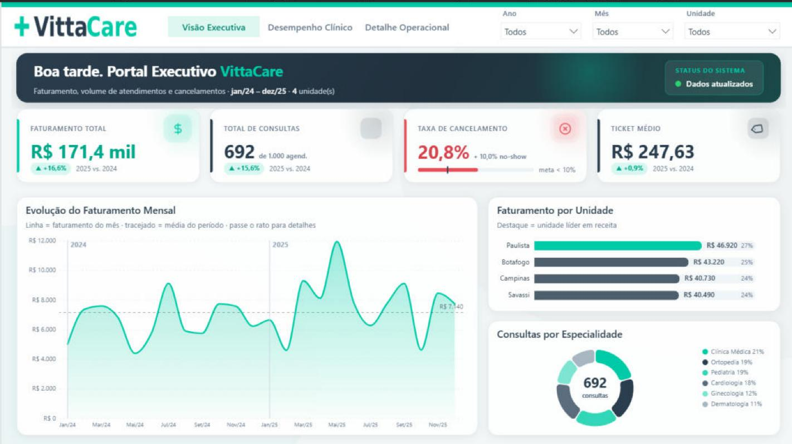
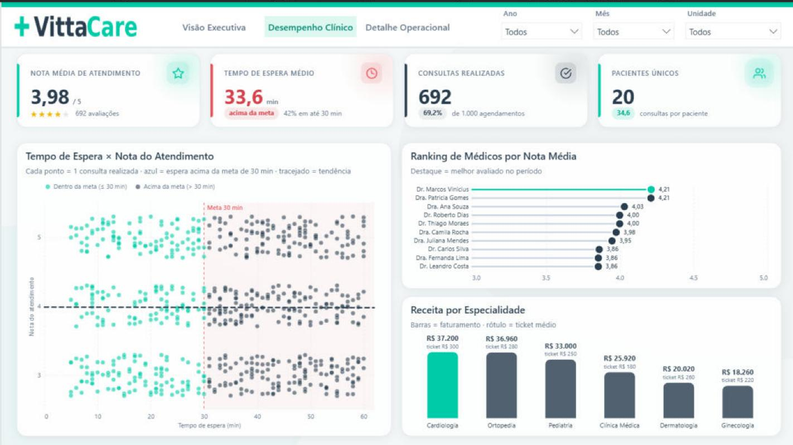
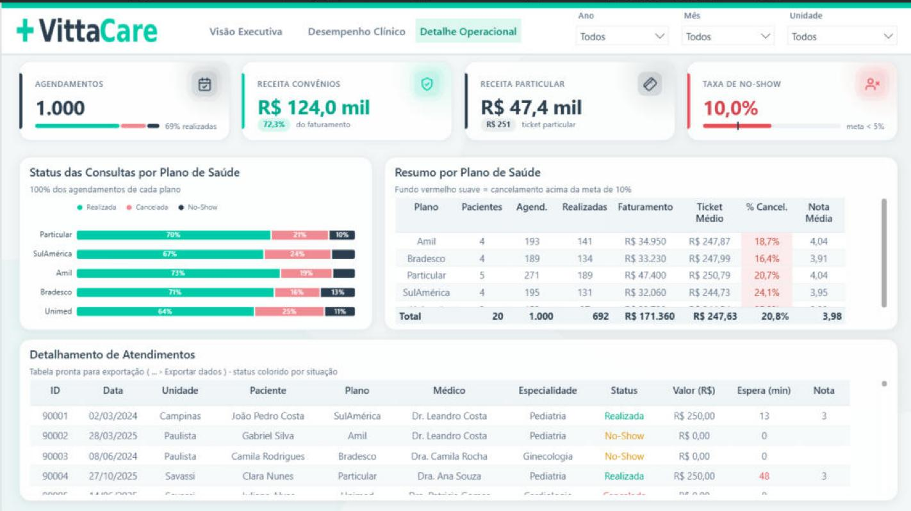
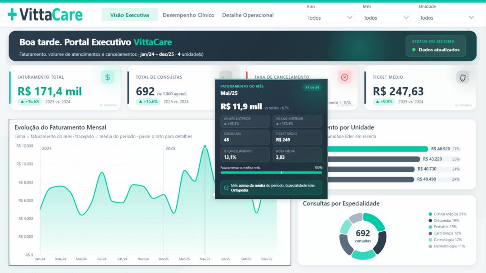
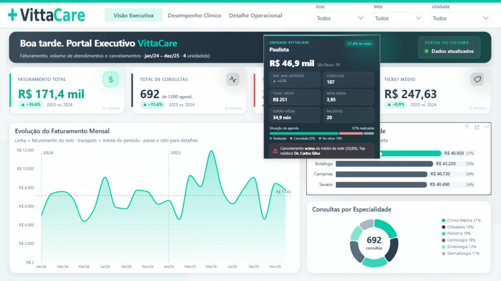
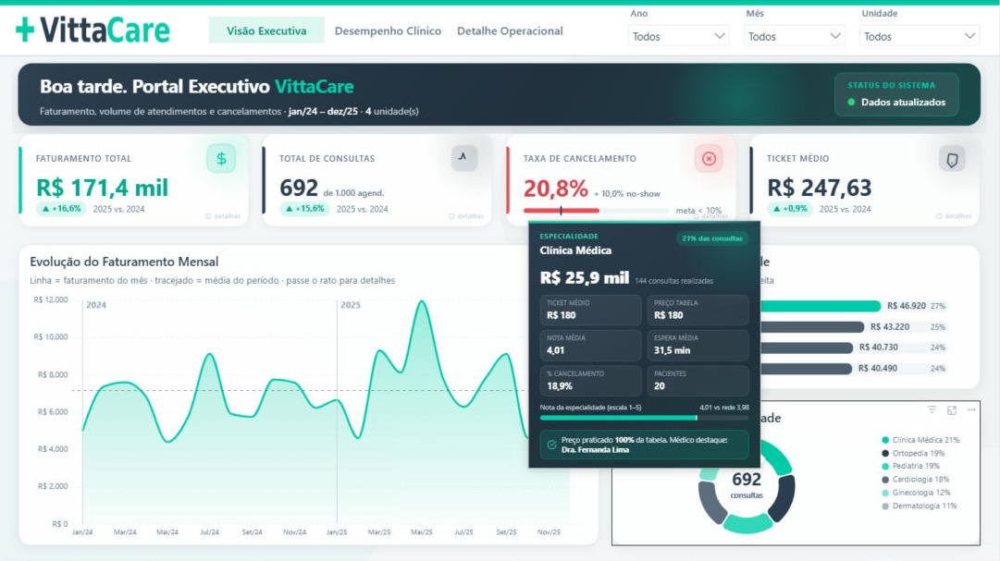
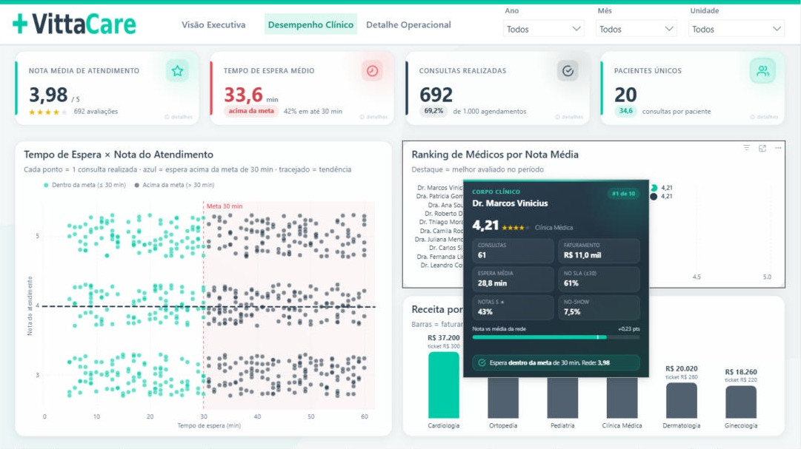
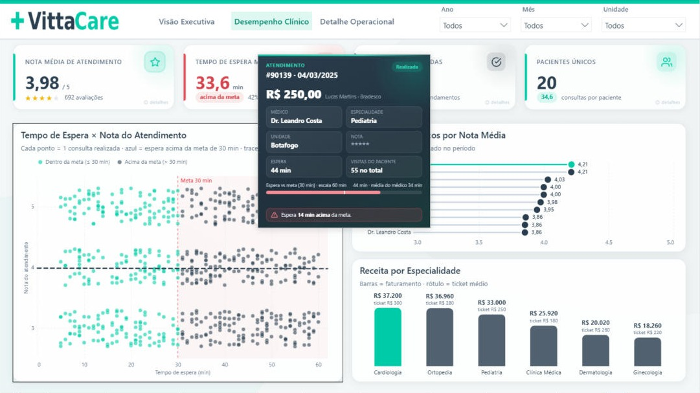
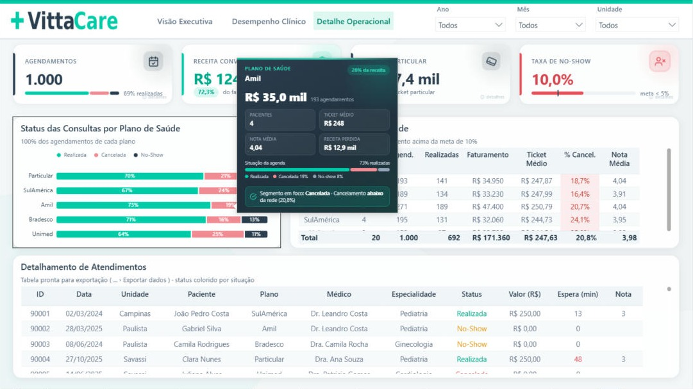
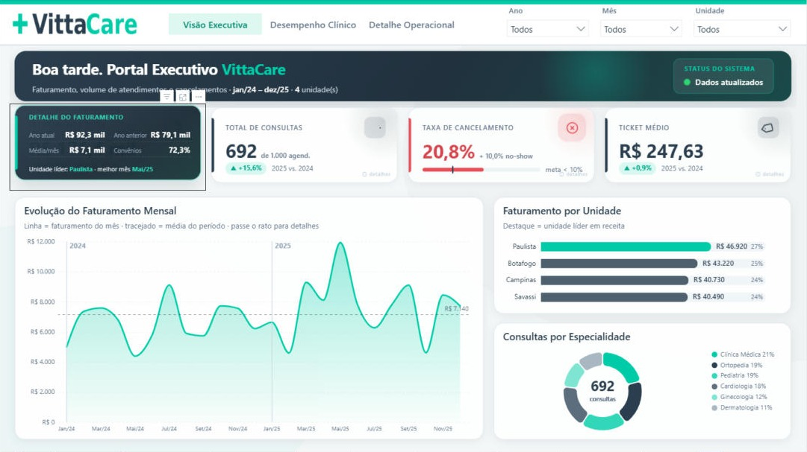

<div align="center">

# 🏥 VittaCare — Dashboard Executivo para Gestão de Rede de Clínicas

**Dashboard executivo em Power BI (Star Schema) para uma rede de clínicas médicas:**
faturamento, volume de atendimentos, cancelamentos/no-show e desempenho clínico em 3 telas,
com cartões em HTML/CSS animado, gráficos **Deneb (Vega-Lite)** e **tooltips personalizados** por visual.

`Power BI` · `PBIP / PBIR` · `TMDL` · `DAX` · `Deneb` · `HTML Content`

> ⚠️ **Projeto conceitual, com dados fictícios, criado para portfólio.** A VittaCare não é uma empresa real.

</div>

---

## 📸 Visão geral

| Visão Executiva | Desempenho Clínico | Detalhe Operacional |
|:---:|:---:|:---:|
|  |  |  |

### Tooltips HTML animados (dica de ferramenta por visual)

| Mês / Evolução | Unidade | Especialidade |
|:---:|:---:|:---:|
|  |  |  |

| Médico | Atendimento | Plano de Saúde |
|:---:|:---:|:---:|
|  |  |  |

Além disso, os 12 cartões de KPI têm um **painel de hover** que revela 4 métricas extras + um insight:



---

## 🎯 Contexto e objetivos

Redes de clínicas geram muitos dados (consultas, médicos, planos, faltas), mas a gestão
costuma decidir no escuro ou em planilhas soltas. O objetivo foi **centralizar faturamento,
operação e qualidade clínica num painel único** — pronto para um C-level ler em 30 segundos
e para a operação explorar no detalhe, com design limpo (glassmorphism sutil / flat design).

## 🧱 Arquitetura (Star Schema)

```
                 Dim_Calendario (Data)            Dim_Clinicas (ID_Clinica)
                          \  1:*                    1:*  /
 Dim_Pacientes (ID_Paciente) ──1:*──  Fato_Atendimentos  ──*:1── Dim_Medicos (ID_Medico)
                                             │
                                            *:1
                                   Dim_Especialidades (ID_Especialidade)
```

- **1 tabela fato** (`Fato_Atendimentos`, 1.000 linhas, 2024–2025) + **5 dimensões** + `Dim_Calendario`.
- `ID_Especialidade` é trazido para a fato no Power Query → estrela pura, sem *snowflake*.
- Medidas organizadas numa tabela `_Medidas` (pastas 01 a 08).

## 🛠️ Stack técnico

| Camada | Tecnologia |
|---|---|
| Modelagem | Star Schema em **TMDL** |
| Métricas | **DAX** (KPIs, comparativos ano a ano, formatação condicional) |
| Cartões de KPI | **HTML / CSS** animado (visual *HTML Content*) |
| Gráficos | **Deneb (Vega-Lite)** — barras arredondadas, lollipop, área com gradiente, donut, scatter |
| Tooltips | 6 páginas de *dica de ferramenta* em HTML/CSS animado |
| Formato | **PBIP / PBIR** (texto, versionável em Git) |
| Identidade | Verde Esmeralda `#00CBA9` · Azul Marinho `#2C3E50` · Cinza Nuvem `#F4F7F9` · fonte Inter |

## 📊 Insights da base (dados fictícios)

- 🔴 **30,8%** dos agendamentos viram cancelamento ou no-show — o dobro da meta (~**R$ 76 mil** de receita não realizada).
- ⏱️ **Tempo de espera médio de 34 min** (meta 30), com correlação com notas de atendimento mais baixas.
- 📈 Faturamento e qualidade variam muito entre unidades, médicos e especialidades.

## 📂 Estrutura do repositório

```
VittaCare.pbip                  → arquivo do projeto (abrir no Power BI Desktop)
VittaCare.Report/               → relatório PBIR (páginas, visuais, tema, imagens)
VittaCare.SemanticModel/        → modelo em TMDL (tabelas, medidas, relações)
dados/VittaCare_Database.xlsx   → base de dados fictícia (fonte)
docs/GUIA_IMPLEMENTACAO.md      → guia completo: DAX, JSON Deneb e HTML dos cartões/tooltips
images/                         → prints das páginas e dos tooltips
```

## ▶️ Como abrir

1. Instale (uma vez) os visuais gratuitos da **AppSource**: **Deneb** e **HTML Content**.
2. Abra `VittaCare.pbip` no **Power BI Desktop** (versão recente, com modo de desenvolvedor/PBIR).
3. Se aparecer aviso de dados, clique **Atualizar agora** (a fonte é `dados/VittaCare_Database.xlsx`).
   - O caminho fica num parâmetro `PastaDados`; ajuste-o em *Transformar dados › Gerir parâmetros* se mover a pasta.

---

<div align="center">
<sub>Projeto de portfólio · dados fictícios · feito por <a href="https://github.com/fbstiago-afk">@fbstiago-afk</a></sub>
</div>
